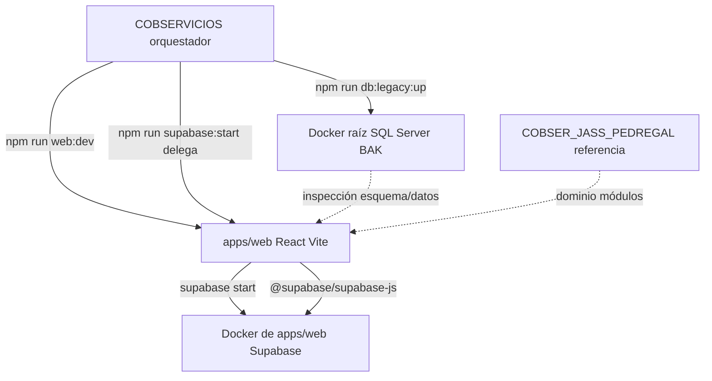

# Plan: Orquestador + apps/web + harness IA

## Contexto

- Legado intacto: `COBSER_JASS_PEDREGAL/` (VB.NET) y `DB_JASS_PEDREGAL.BAK` (SQL Server).
- El producto nuevo vive en **`apps/web`**.
- La raíz `COBSERVICIOS` solo orquesta. No es el app React.
- **Dos Docker independientes (regla dura):**
  - **`apps/web` → Docker propio (Supabase):** `supabase start` anclado a `apps/web/supabase/` (Postgres, Auth, Storage, Studio). Backend real de la app.
  - **Raíz → Docker solo legado:** SQL Server para el `.BAK`. No es el backend de `apps/web`.
- El orquestador no mezcla stacks: `supabase:*` delega a `apps/web`; `db:legacy:*` usa el compose raíz.

## Estructura objetivo

```text
COBSERVICIOS/                          # orquestador (NO dueño del Docker de la app)
  package.json                         # scripts que delegan
  docker-compose.yml                   # SOLO SQL Server (legado / BAK)
  docker/sqlserver/restore/
  apps/
    web/                               # React + dueño de su Docker
      package.json
      vite.config.ts
      src/...
      supabase/                        # `supabase start` = Docker de la app
      .cursor/rules/
      AGENTS.md
      .env.example
  COBSER_JASS_PEDREGAL/
  DB_JASS_PEDREGAL.BAK
  README.md
```



## Stack en apps/web

- React + TypeScript + Vite, Tailwind, shadcn/ui, Lucide, RHF, Zod, TanStack Query, `@supabase/supabase-js`

### Arquitectura modular + Atomic Design

```text
apps/web/src/
  app/
  modules/<name>/{api,schemas,pages,components,types,index.ts}
  design-system/{tokens,atoms,molecules,organisms,templates}
  shared/lib/
  components/ui/   # solo shadcn generado
```

## Orquestador

- `web:*` → `apps/web`
- `supabase:*` → `cd apps/web && npx supabase …` (Docker de la app)
- `db:legacy:*` → compose raíz SQL Server
- Compose raíz **no** incluye Postgres/Auth/Studio

## Harness IA en apps/web

AGENTS.md + `.cursor/rules/` (architecture, design-system, modules, forms-data, supabase, legacy-reference).

## Alcance de esta fase

Scaffold + design-system mínimo + Docker propio Supabase en apps/web + SQL Server legado en raíz + harness. Sin migración BAK→Postgres ni pantallas de negocio.
